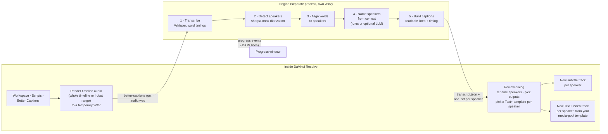

# Better Captions for DaVinci Resolve

Speaker-aware transcription for DaVinci Resolve: detects who is speaking, names
speakers from context, and builds per-speaker subtitle tracks or styled Text+
caption tracks using templates from your media pool.

> [!WARNING]
> **AI-generated ("vibe-coded") project, not fully tested.** This code was written largely by AI
> coding agents. Its automated tests use fake speech models and a simulated Resolve, so it has
> **not yet been verified inside a real DaVinci Resolve** or on real recordings. Expect rough edges,
> try it on a copy of your project first, and please report issues. See [TODO.md](TODO.md).
>
> **Resolve 21.1 and later need Resolve Studio:** Blackmagic moved Python scripting out of the
> free edition in 21.1. The free edition works up to 21.0.x.

## Install

**Before you start:** you need DaVinci Resolve Studio, or the free edition up to 21.0.x
(Resolve 21.1 made Python scripts Studio-only). See [Install details](#install-details) for
everything the installer does.

### Option A: from GitHub

1. Close DaVinci Resolve.
2. Open a terminal: **PowerShell** on Windows, **Terminal** on macOS or Linux.
3. Run the command for your OS:

   Windows:

       irm https://raw.githubusercontent.com/anthonymendez/DavinciResolveBetterTranscription/main/install/install.ps1 | iex

   macOS / Linux:

       curl -fsSL https://raw.githubusercontent.com/anthonymendez/DavinciResolveBetterTranscription/main/install/install.sh | bash

4. Accept the prompts (Windows may show one admin prompt to install Python).
5. Start Resolve and open **Workspace > Scripts > Better Captions**.

This installs the [latest release](https://github.com/anthonymendez/DavinciResolveBetterTranscription/releases/latest).

### Option B: from a local copy

For a clone, a branch with your own changes, or a zip from **Code > Download ZIP**.

1. Close DaVinci Resolve.
2. Get the project onto your computer: `git clone` it, or download the zip and extract it.
3. Open a terminal in the project folder (the one with `pyproject.toml`). On Windows use
   PowerShell in Windows, not WSL.
4. Run the command for your OS:

   Windows:

       $env:BETTER_CAPTIONS_SOURCE = (Get-Location).Path
       powershell -ExecutionPolicy Bypass -File .\install\install.ps1

   macOS / Linux:

       BETTER_CAPTIONS_SOURCE="$PWD" bash install/install.sh

5. Start Resolve and open **Workspace > Scripts > Better Captions**.

Changed the plugin's code? Run `uv run python resolve_plugin/build_plugin_zip.py` before
step 4: the installer copies the zip, not `resolve_plugin/src`.

### Upgrade or uninstall

- **Upgrade:** run the same install command again.
- **Uninstall:** run `uninstall.ps1` / `uninstall.sh` the same way, e.g.
  `curl -fsSL https://raw.githubusercontent.com/anthonymendez/DavinciResolveBetterTranscription/main/install/uninstall.sh | bash`
  or, from a local copy, `powershell -ExecutionPolicy Bypass -File .\install\uninstall.ps1` /
  `bash install/uninstall.sh`.

### Install details

**What the installer does.** It sets up [uv](https://docs.astral.sh/uv/) if missing, puts the
engine in its own Python 3.12 venv in your user data dir, and copies the plugin (the launcher
and `better_captions_plugin.zip`) into Resolve's `Scripts/Utility` folder. On Windows and
Linux, if it finds an NVIDIA GPU it also installs the CUDA runtime (cuBLAS + cuDNN, about
1.5 GB) into the engine venv, so the GPU works without a separate CUDA install; without one,
the engine runs on the CPU. Run `better-captions doctor` (the installer prints the full
command) to see what the engine detects, and see [docs/GPU.md](docs/GPU.md). The first run
in Resolve downloads the speech models (several GB for `large-v3-turbo`).

**Resolve edition.** The free edition of Resolve works up to 21.0.x. Resolve 21.1 moved
Python scripting to Studio, so on the free edition of 21.1 and later the plugin cannot run
(it says so if Resolve starts it at all; see
[docs/RESOLVE_INTEGRATION.md](docs/RESOLVE_INTEGRATION.md) §9).

**Python for Resolve.** Resolve runs the plugin with a system Python it finds by itself: a
64-bit Python 3.10–3.12 with tkinter. (The plugin's own code is tested on 3.10–3.14; whether
Resolve 21 finds a 3.13 or newer install isn't confirmed yet.) If you already have one where
Resolve looks, the installer uses it; otherwise:

- Windows: installs Python 3.12 from python.org for all users (via winget when
  available). This is the only step that needs admin rights: Windows shows one
  UAC prompt, because Resolve only finds Python installed under `C:\Program Files`.
- macOS: offers to install the python.org Python 3.12 package, which runs
  `sudo installer` and asks for your password. Nothing is installed without your
  yes; when run non-interactively it only tells you what to install.
- Linux: installs no system packages; it prints the command to run, e.g.
  `sudo apt-get install python3 python3-tk`.

Restart Resolve after Python is installed, or the script won't show up in the menu.

**Options** (environment variables, set before running the installer):

- `BETTER_CAPTIONS_REF`: git branch, tag or commit to install. By default the
  installer picks the [latest release](https://github.com/anthonymendez/DavinciResolveBetterTranscription/releases/latest),
  falling back to `main` (with a warning) if there is none or GitHub's API can't
  be reached; set `BETTER_CAPTIONS_REF=main` for the development version
- `BETTER_CAPTIONS_HOME`: install somewhere other than the default data dir
- `BETTER_CAPTIONS_SOURCE`: install from a local copy instead of GitHub (Option B)
- `BETTER_CAPTIONS_SKIP_SYSTEM_PYTHON=1`: skip the system Python check/install
- `BETTER_CAPTIONS_GPU`: `auto` (default) installs the NVIDIA CUDA runtime only when
  an NVIDIA GPU is found, `cuda` always installs it, `none` never does
- `BETTER_CAPTIONS_DEBUG=1`: turn on the plugin's debug log (see [Debug logs](#debug-logs))

### Debug logs

If something goes wrong in Resolve, reinstall with debug logging on, reproduce the problem and
send the log. Close Resolve first, then run one of these:

- Windows, from GitHub:

      irm https://raw.githubusercontent.com/anthonymendez/DavinciResolveBetterTranscription/main/install/install-debug.ps1 | iex

- macOS / Linux, from GitHub:

      curl -fsSL https://raw.githubusercontent.com/anthonymendez/DavinciResolveBetterTranscription/main/install/install-debug.sh | bash

- Or set the variable before the normal installer, e.g. in PowerShell
  `$env:BETTER_CAPTIONS_DEBUG = '1'` and then the Option A command (the variable stays set
  in that window), or `BETTER_CAPTIONS_DEBUG=1 bash install/install.sh` on macOS / Linux.
- From a local copy (in the project folder, as in Option B):

      $env:BETTER_CAPTIONS_SOURCE = (Get-Location).Path
      powershell -ExecutionPolicy Bypass -File .\install\install-debug.ps1

  or `BETTER_CAPTIONS_SOURCE="$PWD" bash install/install-debug.sh` on macOS / Linux.

Each run of Better Captions then writes a log to the `logs` folder of the data dir:
`%LOCALAPPDATA%\BetterCaptions\logs` on Windows, `~/Library/Application Support/BetterCaptions/logs`
on macOS, `~/.local/share/BetterCaptions/logs` on Linux (the newest 20 are kept). The summary
and error dialogs end with the log's path. Send the newest `better-captions-*.log` along with
what you did. It records every call the plugin makes to Resolve's API, what Resolve offers for
rendering, and the engine's full output.

The log can contain file paths and transcript text; API keys and other secrets are redacted.
To turn debug logging off, reinstall normally (the plain install command).

### API keys for LLM speaker naming

Naming speakers with Claude or an OpenAI-compatible service needs an API key
(local servers such as Ollama don't). Store it in your OS keychain (Windows
Credential Manager, macOS Keychain, or the Secret Service on Linux) rather
than in a file:

    better-captions key set anthropic      # prompts for the key; or pipe it in with --stdin
    better-captions key set openai
    better-captions key status             # where each key is set; never prints the key
    better-captions key delete anthropic

The engine looks for a key in this order: an explicit option, the
`ANTHROPIC_API_KEY` / `OPENAI_API_KEY` environment variable, the keychain
(service `better-captions`), and finally a plain-text `anthropic_api_key` /
`openai_api_key` in `config.json` from older setups, which logs a warning. Move
those into the keychain with `better-captions key migrate`; it removes them from
`config.json` and keeps your other settings.

On a headless Linux machine without a Secret Service there is no keychain;
the `key` commands say so, and you set the environment variables instead.

### Speaker naming with Claude Code or Antigravity (no API key)

If you already use a coding-agent CLI that you're signed in to, speaker naming
can use it instead of an API key:

- `claude-cli`: [Claude Code](https://claude.com/claude-code) (`claude`). The
  transcript is sent to **Anthropic** under your Claude account and counts
  towards that account's usage. Runs `claude -p … --output-format json --tools ""`
  with the `haiku` model by default.
- `antigravity-cli`: Google's Antigravity CLI (`agy`). The transcript is sent to
  **Google** under your Antigravity/Google account and its terms. Runs
  `agy -p … --output-format json`.

Pick one in the review dialog under *Speaker naming (next run)*, or set
`"naming_provider"` in `config.json` (`better-captions run --naming claude-cli`
on the command line). With the default `auto`, the engine uses an Anthropic API
key if it has one, then an OpenAI-compatible setup, then `claude`, then `agy`,
and otherwise the local rules. Choose *Rules only* to keep the transcript on
your machine.

The CLI runs non-interactively in an empty temporary folder with no tools and
no permission bypass, with a 120-second time limit. The transcript is passed on
the command line, so long recordings are shortened (the start and end are kept)
to fit the operating system's limit. If the CLI is missing, not signed in,
fails or times out, naming falls back to the local rules.

Resolve starts the engine with a minimal `PATH`, so the CLIs are also looked for
in `~/.local/bin`, `~/.claude/local`, `/opt/homebrew/bin`, `/usr/local/bin`,
`%LOCALAPPDATA%\Programs` and `%APPDATA%\npm`. `better-captions doctor` shows
what it found under `naming_clis`. Optional `config.json` settings:

| Key | Meaning |
| --- | --- |
| `claude_cli_path`, `antigravity_cli_path` | full path to `claude` / `agy` when it isn't found |
| `claude_cli_model`, `antigravity_cli_model` | model to ask for (`--model`); claude defaults to `haiku` |
| `naming_cli_timeout` | seconds before giving up (default 120) |

When the timeline has two or more audio tracks, the plugin asks which ones to
transcribe. Only those are rendered, and your tracks are switched back as they
were afterwards. If the timeline audio hasn't changed since the last run, the
previous render (kept in `<data>/renders`) is reused. Set `"force_rerender": true`
in `config.json` to always render again. The progress window lists the steps
left and has a Pause button.

If only one person talks on a track (your own microphone, say), type their name
next to it in that dialog. That track is also rendered alone, and everything
said on it is captioned as that person, named already in the review. Speaker
detection then only has to sort out everyone else. Names are remembered per
timeline. On the command line this is `--fixed-track NAME=PATH` (repeatable),
where PATH is that track's audio on its own.

## How it works

The plugin has two halves. The **Resolve plugin** runs inside Resolve and only
uses the Python standard library. The **engine** runs as a separate process in
its own Python environment, where the heavy speech models live. They talk through
a command line and JSON files, so Resolve never loads the models itself.



1. **Render audio.** The plugin renders the current timeline's audio (or just
   the marked in/out range) to a WAV file.
2. **Transcribe.** [faster-whisper](https://github.com/SYSTRAN/faster-whisper)
   turns speech into text with a start and end time for every word. It uses an
   NVIDIA GPU when one is available, otherwise the CPU.
3. **Detect speakers.** [sherpa-onnx](https://github.com/k2-fsa/sherpa-onnx)
   works out who spoke when. It runs locally and needs no account or token.
   The models download once on first use.
4. **Align.** Each word gets the speaker who was talking at that moment, and
   words are grouped into sentences per speaker.
5. **Name speakers.** The engine looks for names in the conversation, such as
   self-introductions ("I'm Sam") and people addressing each other ("thanks,
   Maria"). Optionally it asks Claude, OpenAI, a local model through Ollama,
   or your signed-in Claude Code / Antigravity CLI for better guesses. If no name is found, the speaker stays `SPEAKER_00` and
   so on, and you can type one in.
6. **Build captions.** Sentences are split into readable captions (at most 42
   characters per line, 2 lines, 6 seconds by default).
7. **Review and create tracks.** You confirm names and outputs, and the plugin
   adds new tracks. Existing tracks are never changed.

Everything except the optional LLM naming runs on your machine. See
[docs/ARCHITECTURE.md](docs/ARCHITECTURE.md) for the engine/plugin contract and
[docs/RESOLVE_INTEGRATION.md](docs/RESOLVE_INTEGRATION.md) for the Resolve API
calls used and their known limitations.

## What the UI looks like

On Resolve Studio the plugin uses Resolve's own dialog toolkit. On the free
version, where that toolkit isn't available to scripts, it uses standard
system windows (tkinter). Both show the same two dialogs.

**1. Progress** while the engine works:

```
┌─ Better Captions ──────────────────────────────────────────────┐
│  Detecting speakers… 62%                                       │
│  [██████████████████████████████░░░░░░░░░░░░░░░░░░░░░░░░]       │
│                                                     [ Cancel ] │
└────────────────────────────────────────────────────────────────┘
```

The stages are *Transcribing*, *Detecting speakers*, *Aligning words to
speakers*, *Naming speakers* and *Writing captions*. The first run is slower
because the models download.

**2. Review speakers** before anything is added to your timeline:

```
┌─ Better Captions – review speakers ──────────────────────────────────────────────────┐
│  Timeline: Episode 12   Range: 01:00:00:00 – 01:12:34:10                             │
│                                                                                      │
│  Speaker      Name (track name)      Text+ template              Says, e.g.          │
│  SPEAKER_00   [ Jordan           ]   [ Captions/Yellow Pop  ▾ ]  "Hey Maria, how a…" │
│  SPEAKER_01   [ Maria            ]   [ Captions/Blue Clean  ▾ ]  "Good, thanks Jor…" │
│  SPEAKER_02   [ SPEAKER_02       ]   [ Captions/Default     ▾ ]  "Can you two hear…" │
│                                                                                      │
│  [x] Subtitle tracks: one subtitle track per speaker, named after the speaker        │
│  [x] Text+ captions: one video track per speaker using the chosen template           │
│      [ ] Highlight words as they're spoken     Highlight colour: [#FFD400] [Pick…]   │
│  New tracks are added; existing tracks are never changed.                            │
│                                                          [ Create tracks ] [ Cancel ]│
└──────────────────────────────────────────────────────────────────────────────────────┘
```

- **Name:** pre-filled with the name the engine inferred. Whatever you type
  becomes the track name.
- **Text+ template:** lists every Text+ / Fusion title found in any bin of your
  media pool. Make a styled caption once per speaker (font, colour, position)
  and pick it here.
- **Says, e.g.:** a sample line, so you can tell who is who.
- **Outputs:** tick either output or both.
- **Highlight words as they're spoken** (Text+ only, off by default): each caption becomes
  one clip per word, each showing the whole caption in your template with the spoken word
  in the highlight colour. Your choice and colour are remembered for the next run. See
  `docs/RESOLVE_INTEGRATION.md` §8 for how it works and its limits.

**Result on the timeline:**

```
 V3  Maria (Text+)    ▭ Good, thanks… ▭       ▭ Sure! ▭
 V2  Jordan (Text+) ▭ Hey Maria… ▭  ▭ So today… ▭
 V1  Video          ████████████████████████████████████
 ST2 Maria            ▭ Good, thanks… ▭       ▭ Sure! ▭
 ST1 Jordan         ▭ Hey Maria… ▭  ▭ So today… ▭
```

Each speaker can then be muted, styled, or moved independently.

**3. Fix speakers…** (button in the review dialog) for when speaker detection
gets it wrong:

```
┌─ Better Captions – fix speakers ───────────────────────────────────────────────┐
│  Speakers                          Cues            Show: [ All speakers   ▾ ]  │
│  ┌───────────────────────────┐     ┌─────────────────────────────────────────┐ │
│  │ SPEAKER_00  Jordan    41  │     │ 00:00:01  Jordan  Hey Maria, how are…   │ │
│  │ SPEAKER_01  Maria     37  │     │ 00:00:03  Maria   Good, thanks Jordan.  │ │
│  │ SPEAKER_02  Jordan?    4  │     │▸00:00:07  Maria   So today we're going… │ │
│  └───────────────────────────┘     │ 00:00:12  Jordan  Right, let's start.   │ │
│  Name: [ Jordan        ] [Rename]  └─────────────────────────────────────────┘ │
│  Merge into: [ SPEAKER_00 ▾ ] [Merge]  Move selected to: [ SPEAKER_00 ▾ ] [Move]│
│                                                             [ Undo ]  [ Done ] │
└────────────────────────────────────────────────────────────────────────────────┘
```

- **Merge:** when one person was split into two speakers, merge one into the
  other. The speaker you merge into keeps its name.
- **Move:** when lines were credited to the wrong person, select them and move
  them to another speaker, or to a new one.
- **Undo** steps back through your changes.

Your fixes are saved per audio file, so re-running on the same audio applies
them again.
