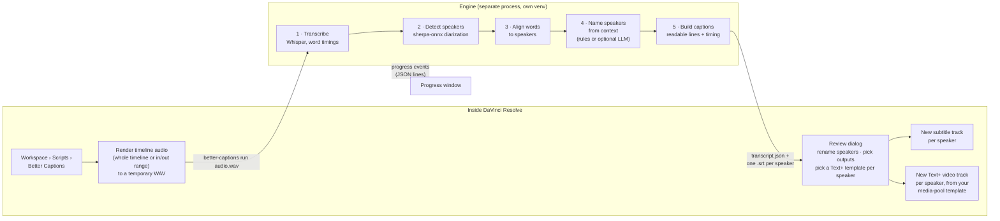

# Better Captions for DaVinci Resolve

Speaker-aware transcription for DaVinci Resolve: detects who is speaking, names
speakers from context, and builds per-speaker subtitle tracks or styled Text+
caption tracks using templates from your media pool.

> [!WARNING]
> **AI-generated ("vibe-coded") project, not fully tested.** This code was written largely by AI
> coding agents. Its automated tests use fake speech models and a simulated Resolve, so it has
> **not yet been verified inside a real DaVinci Resolve** or on real recordings. Expect rough edges,
> try it on a copy of your project first, and please report issues. See [TODO.md](TODO.md).

## Install

Windows (PowerShell):

    irm https://raw.githubusercontent.com/anthonymendez/DavinciResolveBetterTranscription/main/install/install.ps1 | iex

macOS / Linux:

    curl -fsSL https://raw.githubusercontent.com/anthonymendez/DavinciResolveBetterTranscription/main/install/install.sh | bash

Then in Resolve: **Workspace > Scripts > Better Captions**.

The installer sets up [uv](https://docs.astral.sh/uv/) if missing, puts the
engine in its own Python 3.12 venv in your user data dir, and copies the plugin
into Resolve's `Scripts/Utility` folder. An NVIDIA GPU with CUDA is used
automatically if available. Re-run the same command to upgrade.

Requirements: Resolve runs the plugin with a system Python it finds by itself,
a 64-bit Python 3.10–3.12 with tkinter. If you already have one where Resolve
looks, the installer uses it; otherwise:

- Windows: installs Python 3.12 from python.org for all users (via winget when
  available). This is the only step that needs admin rights: Windows shows one
  UAC prompt, because Resolve only finds Python installed under `C:\Program Files`.
- macOS: offers to install the python.org Python 3.12 package, which runs
  `sudo installer` and asks for your password. Nothing is installed without your
  yes; when run non-interactively it only tells you what to install.
- Linux: installs no system packages; it prints the command to run, e.g.
  `sudo apt-get install python3 python3-tk`.

Restart Resolve after Python is installed.

Options (environment variables):

- `BETTER_CAPTIONS_REF`: git branch/tag to install (default `main`)
- `BETTER_CAPTIONS_HOME`: install somewhere other than the default data dir
- `BETTER_CAPTIONS_SOURCE`: install from a local checkout instead of GitHub
- `BETTER_CAPTIONS_SKIP_SYSTEM_PYTHON=1`: skip the system Python check/install

To uninstall, run `install/uninstall.ps1` or `install/uninstall.sh` the same
way (e.g. `curl -fsSL .../install/uninstall.sh | bash`).

## How it works

The plugin has two halves. The **Resolve plugin** runs inside Resolve and only
uses the Python standard library. The **engine** runs as a separate process in
its own Python environment, where the heavy speech models live. They talk through
a command line and JSON files, so Resolve never loads the models itself.



1. **Render audio.** The plugin renders the current timeline's audio (or just
   the marked in/out range) to a WAV file.
2. **Transcribe.** [faster-whisper](https://github.com/SYSTRAN/faster-whisper)
   turns speech into text with a start and end time for every word. It uses an
   NVIDIA GPU when one is available, otherwise the CPU.
3. **Detect speakers.** [sherpa-onnx](https://github.com/k2-fsa/sherpa-onnx)
   works out who spoke when. It runs locally and needs no account or token.
   The models download once on first use.
4. **Align.** Each word gets the speaker who was talking at that moment, and
   words are grouped into sentences per speaker.
5. **Name speakers.** The engine looks for names in the conversation, such as
   self-introductions ("I'm Sam") and people addressing each other ("thanks,
   Maria"). Optionally it asks Claude, OpenAI, or a local model through Ollama
   for better guesses. If no name is found, the speaker stays `SPEAKER_00` and
   so on, and you can type one in.
6. **Build captions.** Sentences are split into readable captions (at most 42
   characters per line, 2 lines, 6 seconds by default).
7. **Review and create tracks.** You confirm names and outputs, and the plugin
   adds new tracks. Existing tracks are never changed.

Everything except the optional LLM naming runs on your machine. See
[docs/ARCHITECTURE.md](docs/ARCHITECTURE.md) for the engine/plugin contract and
[docs/RESOLVE_INTEGRATION.md](docs/RESOLVE_INTEGRATION.md) for the Resolve API
calls used and their known limitations.

## What the UI looks like

On Resolve Studio the plugin uses Resolve's own dialog toolkit. On the free
version, where that toolkit isn't available to scripts, it uses standard
system windows (tkinter). Both show the same two dialogs.

**1. Progress** while the engine works:

```
┌─ Better Captions ──────────────────────────────────────────────┐
│  Detecting speakers… 62%                                       │
│  [██████████████████████████████░░░░░░░░░░░░░░░░░░░░░░░░]       │
│                                                     [ Cancel ] │
└────────────────────────────────────────────────────────────────┘
```

The stages are *Transcribing*, *Detecting speakers*, *Aligning words to
speakers*, *Naming speakers* and *Writing captions*. The first run is slower
because the models download.

**2. Review speakers** before anything is added to your timeline:

```
┌─ Better Captions – review speakers ──────────────────────────────────────────────────┐
│  Timeline: Episode 12   Range: 01:00:00:00 – 01:12:34:10                             │
│                                                                                      │
│  Speaker      Name (track name)      Text+ template              Says, e.g.          │
│  SPEAKER_00   [ Jordan           ]   [ Captions/Yellow Pop  ▾ ]  "Hey Maria, how a…" │
│  SPEAKER_01   [ Maria            ]   [ Captions/Blue Clean  ▾ ]  "Good, thanks Jor…" │
│  SPEAKER_02   [ SPEAKER_02       ]   [ Captions/Default     ▾ ]  "Can you two hear…" │
│                                                                                      │
│  [x] Subtitle tracks: one subtitle track per speaker, named after the speaker        │
│  [x] Text+ captions: one video track per speaker using the chosen template           │
│  New tracks are added; existing tracks are never changed.                            │
│                                                          [ Create tracks ] [ Cancel ]│
└──────────────────────────────────────────────────────────────────────────────────────┘
```

- **Name:** pre-filled with the name the engine inferred. Whatever you type
  becomes the track name.
- **Text+ template:** lists every Text+ / Fusion title found in any bin of your
  media pool. Make a styled caption once per speaker (font, colour, position)
  and pick it here.
- **Says, e.g.:** a sample line, so you can tell who is who.
- **Outputs:** tick either output or both.

**Result on the timeline:**

```
 V3  Maria (Text+)    ▭ Good, thanks… ▭       ▭ Sure! ▭
 V2  Jordan (Text+) ▭ Hey Maria… ▭  ▭ So today… ▭
 V1  Video          ████████████████████████████████████
 ST2 Maria            ▭ Good, thanks… ▭       ▭ Sure! ▭
 ST1 Jordan         ▭ Hey Maria… ▭  ▭ So today… ▭
```

Each speaker can then be muted, styled, or moved independently.

> Coming soon: fixing speaker mistakes in the review dialog (merge speakers,
> move a caption to another speaker), and an optional word-by-word highlight for
> Text+ captions. These are in progress.
